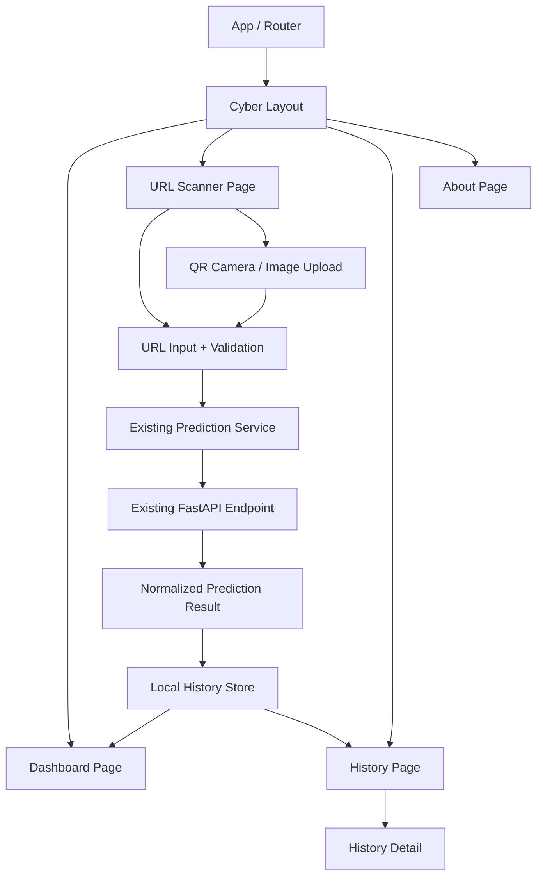
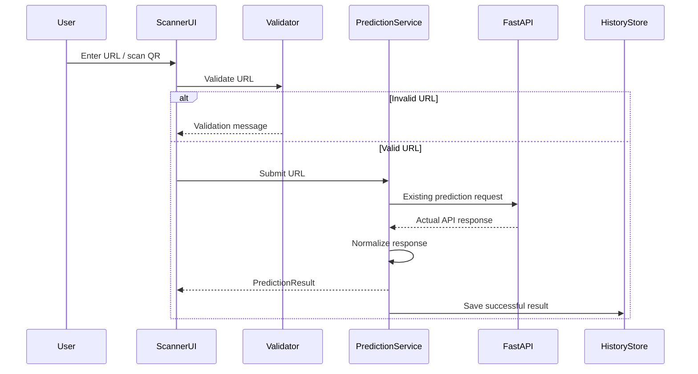

# Design Document — PhishGuard V3

## 1. Overview

V3 mengembangkan pengalaman PhishGuard dengan menambahkan Dashboard, History, detail pemeriksaan, validasi URL yang lebih jelas, dan penyajian hasil yang lebih mudah dipahami. V3 mempertahankan visual cyber/dark V2 dan tidak mengubah model ML atau backend FastAPI tanpa alasan yang terverifikasi.

Prinsip desain:
- **Data-backed UI**: semua angka dashboard berasal dari riwayat nyata.
- **Local-first history**: riwayat tersimpan di browser agar fitur tidak bergantung pada Supabase.
- **Safe interpretation**: hasil prediksi tidak dipresentasikan sebagai jaminan keamanan.
- **Reuse existing flow**: input manual dan QR menggunakan pipeline prediksi yang sama.
- **Progressive enhancement**: animasi tidak boleh menghalangi fungsi utama.

## 2. Existing Technology Context

- Frontend: React 18, TypeScript, Vite, Tailwind CSS v4.
- Backend: FastAPI Python.
- Motion: gunakan `motion/react` bila sudah tersedia di proyek.
- QR: pertahankan library QR yang telah digunakan proyek (V2 menyebut `html5-qrcode`).
- Theme: gunakan tokens V2 (`--cyber-bg`, `--cyber-bg-alt`, `--neon-green`, `--neon-cyan`, `--neon-red`, `--text-primary`, `--glass-bg`, `--glass-border`).
- Jangan menambahkan dependensi baru sebelum memeriksa `package.json`.

## 3. High-level Architecture



## 4. Navigation and Page Structure

Primary navigation:
1. Dashboard — `/`
2. URL Scanner — `/scan`
3. History — `/history`
4. About — `/about`

Jika struktur routing saat ini berbeda, pertahankan pola route yang sudah digunakan dan sesuaikan path tanpa merusak deep link yang ada.

Layout:
- Sidebar cyber/dark pada desktop.
- Navigasi mobile melalui drawer/hamburger atau bottom navigation.
- Active route menggunakan aksen neon-green.
- Konten utama berada di atas background particle layer.
- Hindari menampilkan terlalu banyak efek bergerak secara bersamaan.

## 5. Core Data Model

### 5.1 Normalized Prediction Result

Bentuk ini adalah model internal UI, bukan klaim format API. Buat adapter dari respons FastAPI aktual.

```typescript
type PredictionLabel = "PHISHING" | "LEGITIMATE";

interface PredictionResult {
  label: PredictionLabel;
  confidence?: number;
  legitimateChance?: number;
  rawResponse?: unknown;
}
```

Rules:
- Jangan mengasumsikan field API sebelum memeriksa endpoint dan respons aktual.
- Normalisasi persentase hanya sekali; jangan mengalikan nilai 0–100 dengan 100.
- Bila confidence tidak tersedia, jangan tampilkan nilai buatan.
- Unknown label atau response malformed harus masuk ke error/unsupported state, bukan dipaksa menjadi LEGITIMATE.

### 5.2 Scan History Item

```typescript
interface ScanHistoryItem {
  id: string;
  url: string;
  label: "PHISHING" | "LEGITIMATE";
  confidence?: number;
  legitimateChance?: number;
  scannedAt: string; // ISO 8601
}
```

Local storage key:
```typescript
const HISTORY_STORAGE_KEY = "phishguard.scan-history.v1";
```

Storage service API:
```typescript
interface HistoryStore {
  list(): ScanHistoryItem[];
  add(item: ScanHistoryItem): void;
  remove(id: string): void;
  clear(): void;
}
```

Implementation requirements:
- Validasi dan normalisasi data saat membaca storage.
- Tangani `JSON.parse` error dan storage yang tidak tersedia.
- Gunakan ID unik; jangan gunakan URL sebagai ID karena URL dapat dipindai berulang.
- Batasi jumlah item (misalnya 100 item terbaru) melalui satu konstanta yang mudah diubah.
- Jangan menyimpan gambar QR atau data kamera.
- Jika penyimpanan gagal, hasil prediksi tetap ditampilkan; beri tahu pengguna bahwa riwayat tidak berhasil disimpan.

## 6. URL Validation and Prediction Flow



Validation:
- Trim whitespace.
- Require a parseable URL with an allowed protocol (default `http:` or `https:`).
- Do not claim that syntactic validity means the destination is safe.
- QR-decoded URL is passed through the same validator.
- Keep existing backend request shape unchanged.

UI states:
- `idle`
- `validating`
- `loading`
- `success`
- `error`

Prevent duplicate submissions while `loading`.

## 7. Dashboard Design

Components:
- `DashboardPage`
- `SummaryCard`
- `RecentScans`
- `EmptyState`

Summary cards:
- Total scans.
- Phishing detections.
- Legitimate detections.
- Detection ratio (only if denominator > 0).

All values are derived from `HistoryStore.list()`. Dashboard must show zero/empty state when there is no history. Avoid fake charts or sample counts in production.

Recent scans:
- Show a small number of newest records (e.g. 5).
- Display URL (truncate visually, retain accessible full value), label, and date/time.
- Provide link to history detail.

## 8. History Design

Components:
- `HistoryPage`
- `HistoryToolbar`
- `HistoryList`
- `HistoryItem`
- `HistoryDetail`
- `DeleteConfirmation`

Features:
- Search by URL (case-insensitive substring match).
- Filter: All, PHISHING, LEGITIMATE.
- Sort newest first.
- Delete individual item.
- Clear all with confirmation.
- Empty states for no saved history and no matching search results.

Privacy copy:
"Riwayat disimpan di browser/perangkat ini dan tidak otomatis tersinkronisasi ke perangkat lain. Hapus riwayat jika URL yang diperiksa berisi informasi sensitif."

Do not show raw localStorage contents in the UI.

## 9. Result View Design

Result sections:
1. Status label and icon.
2. Confidence/probability only when present in API response.
3. Plain-language interpretation.
4. Scanned URL.
5. Actions: Copy URL, Scan another URL.

Suggested wording:
- PHISHING: "Model mendeteksi karakteristik yang mengarah pada phishing. Hindari memasukkan informasi pribadi atau kredensial."
- LEGITIMATE: "Model tidak mendeteksi indikasi phishing berdasarkan prediksinya. Tetap periksa domain dan konteks situs sebelum memasukkan informasi."

Always include:
"Prediksi model bukan jaminan keamanan dan dapat menghasilkan false positive atau false negative."

Do not invent feature-level explanations. If the backend later exposes explainability data, design it as a separate verified section.

## 10. QR Scanner Design

- Reuse current camera and image-upload implementation.
- Add ScanFrame overlay only while camera is active.
- Show extracted URL clearly before sending it to prediction.
- Use same URL validation and prediction service as manual entry.
- Stop camera tracks/QR scanner instance on stop and component unmount.
- Handle permission denied, no camera, decode failure, and camera initialization errors.
- Do not upload QR image to prediction endpoint unless the actual API requires it.

## 11. About Page

Sections:
- What is PhishGuard?
- How URL checking works (input/QR → API → model result).
- Technology stack based on repository package/configuration.
- Model information only from verified project artifacts.
- Limitations and responsible-use notice.

Do not hardcode claims such as "95% accuracy" or "30+ features" unless the project contains evidence and the team confirms the values.

## 12. Suggested Frontend Structure

Adapt to the repository's current conventions; this is a suggested structure, not a requirement to move all existing files.

```text
src/
  app/
    components/
      Layout.tsx
      CyberParticles.tsx
      ScanFrame.tsx
      EmptyState.tsx
      SummaryCard.tsx
      HistoryItem.tsx
    pages/
      DashboardPage.tsx
      LinkPredictor.tsx
      HistoryPage.tsx
      AboutUs.tsx
  services/
    predictionService.ts
    historyStore.ts
  utils/
    validateUrl.ts
    normalizePrediction.ts
  types/
    prediction.ts
    history.ts
```

## 13. Error Handling

- API unavailable: show retry message; preserve entered URL.
- Invalid URL: show validation message; do not call API.
- Malformed API response: show a safe error; do not save to history.
- localStorage unavailable/quota exceeded: show result normally and explain history could not be saved.
- Corrupt history JSON: recover to an empty valid list and avoid crashing the app.
- QR permission failure: explain how to allow camera access or use image upload.

## 14. Accessibility and Responsive Behavior

- Minimum viewport width: 320px.
- Mobile pages use single-column layouts.
- All controls have accessible labels.
- Status changes use `aria-live="polite"` or equivalent.
- Error messages use `role="alert"` where appropriate.
- Focus styles use visible cyan outline.
- Status uses text/icon as well as color.
- Honor reduced-motion preferences.

## 15. Testing Strategy

Unit tests:
- URL validator: valid protocols, whitespace, invalid input, unsupported protocols.
- Prediction normalizer: expected fields, missing confidence, malformed response, unknown label.
- History store: add/list/remove/clear, invalid JSON, unavailable storage, max item count.

Component/integration tests:
- Dashboard empty and populated states.
- History search/filter/delete/clear.
- URL validation prevents API call.
- Prediction success and error.
- QR decoded URL follows the same validation flow.
- Result view does not show confidence if absent.

Regression:
- Camera live scan.
- QR image upload.
- Existing API endpoint request and response compatibility.
- Responsive navigation.
- `npm run build` and available lint/test commands.

## 16. Open Questions

- Verify the exact FastAPI endpoint, request payload, response fields, and confidence scale.
- Confirm whether the current project already has a History or Dashboard route.
- Confirm the exact package/test scripts in `package.json`.
- Decide whether history cap should be 100 or another value after checking expected usage.
